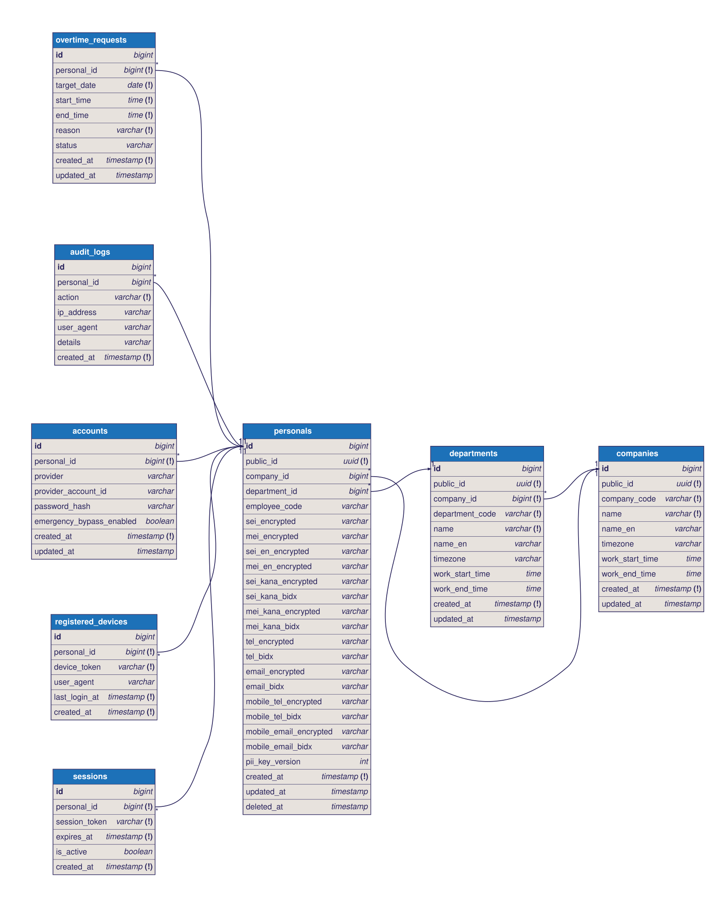

# Project Honjin (プロジェクト本陣)

日本の戦国時代、武将たちが戦況の変化に即座に対応して陣形を組み替えて戦ったように、柔軟かつ強靭なシステムを目指し、本プロジェクトは**「Project Honjin（プロジェクト本陣）」**と名付けられました。

## 概要 (Concept & Architecture)

本システムは、荒波に耐える「洋上プラント（石油プラットフォーム）」の構造からヒントを得た**マイクロカーネル・アーキテクチャ**を採用しています。まずはシステムの中核となる「堅牢で汎用的な土台（本陣）」を構築し、そこへ後から開発した業務機能やモジュールを柔軟にアドオンしていく設計思想を掲げています。

本番環境として、Synology社のNASに構築したWEBサーバーを使います。
インフラ面においては、Synology社のNAS特有のファイルシステム制限やポート競合を完全に回避した安定開発環境を構築。リバースプロキシ（Traefik）をネットワークの司令塔として据え、フロントエンドとバックエンドがシームレスに連携するモダンなアーキテクチャを実現。
将来的なAWSへの移行も視野に入れています。

### Note:

本リポジトリはポートフォリオおよび個人的な開発の記録として公開しています。
現在、他者からのPull RequestやIssueは受け付けておりません。 (Read-only repository)

## 技術スタック

### Frontend
- **React 18** / **TypeScript**
- **Vite** (高速ビルドツール)
- **React Router** (ルーティング)
- **Axios** (API通信)

### Backend
- **Python 3.11+**
- **FastAPI** (高速非同期フレームワーク)
- **SQLModel** (Pydantic + SQLAlchemy)

### Database & Infrastructure
- **PostgreSQL 15**
- **Docker / Docker Compose**
- **Traefik** (API Gateway / Reverse Proxy)

## ディレクトリ構成

```text
p-honjin/
├── frontend/             # React/Vite アプリケーション (アドオンUI群)
├── backend/              # FastAPI アプリケーション (マイクロカーネルAPI)
├── infra/                # インフラ設定 (Traefik, DBデータ領域等)
├── docker-compose.yml    # コンテナオーケストレーション設定
└── README.md
```

## データベース設計図 (ER図)


